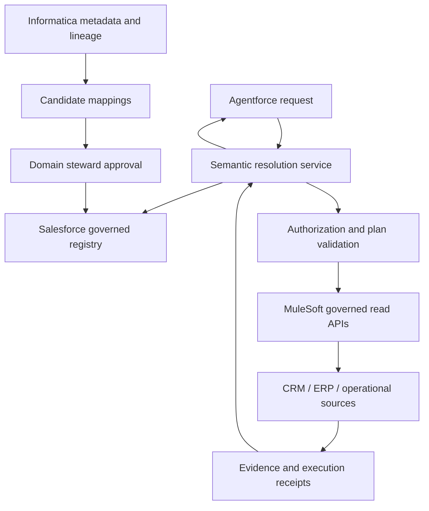

# Architecture and implementation brief

## 1. Ownership and boundaries

“Salesforce-governed” means definitions, versions, approvals, and action bindings are managed through a Salesforce-centered control plane. Business/domain stewards retain authority over their definitions. It does not mean Salesforce becomes the system of record for every ERP transaction, or that its policy overrides a source system's access controls.

Proposed responsibilities, not verified statements of available end-to-end functionality:

- **Salesforce semantic registry:** canonical concept IDs; definitions; domain extensions; version lifecycle; effective dates; approver evidence; source and action bindings.
- **Informatica adapter:** metadata identifiers, classifications, glossary candidates, lineage, quality observations, refresh timestamps. Imports propose mappings; they cannot approve themselves.
- **MuleSoft adapter:** versioned read/action APIs with bounded schemas, authenticated caller context, policies, runtime authorization, and receipts.
- **Semantic resolution service:** match a request to an approved definition, ask about ambiguity, assemble a bounded read plan, and package cited evidence. Deploy location is an open implementation choice.
- **Agentforce:** proposed conversational entry point and action consumer. The agent proposes a plan; deterministic services validate it.
- **Source systems:** authoritative transaction data and final source authorization.

## 2. Proposed registry implementation

Check existing platform capabilities first. If a custom registry is necessary, the following are **proposed custom objects**, not existing Salesforce standard objects:

- `BusinessConcept__c`: stable semantic ID, label, domain, description, steward.
- `ConceptVersion__c`: immutable definition payload/hash, version, status, effective interval, approval reference, superseded version.
- `SemanticRelationship__c`: source and target concept-version references, predicate, cardinality, temporal qualifiers.
- `SourceBinding__c`: concept-version reference, external catalog ID, source schema version, transformation, provenance, refresh policy.
- `ActionBinding__c`: concept-version reference, API/version/operation, input/output schema hashes, required scope, side-effect class.
- `SemanticDecision__c`: request/correlation ID, definition version, policy decision reference, source receipts, outcome; redact sensitive values and apply retention.

Use records for governed runtime definitions; use deployable configuration only for stable bootstrap settings. Storage, limits, sharing, retention, and deployment approach need sandbox validation. Do not store source credentials in ontology records.

Lifecycle: **draft → review → approved → deprecated/revoked**. Rejection returns to draft. Definition changes create a new immutable version, not silent edits. Production approvals require authenticated steward evidence. LLM suggestions and catalog imports remain drafts. Rollback selects an earlier still-valid approved version; it does not bypass revocation.

## 3. Oil & Gas scope

Model a graph, not a linear chain:

- Account participates in an OperatorRole; an operator is a business role, not universally a separate legal entity.
- OperatorRole operates an Asset for an effective interval; operation and ownership are separate predicates.
- Well is a specialization of Asset; IDs are namespaced and require verified cross-system mapping.
- ProductionObservation measures a Well for a period, commodity, quantity unit, and measurement basis.
- Contract links counterparties and covered assets; coverage can be many-to-many.
- RevenueEntry references a contract, account, accounting period, currency, and recognition basis.
- A production observation does **not** imply a revenue amount without prices, allocation, entitlement, and accounting rules.

The starter JSON is a lightweight semantic registry format, not an OWL reasoner or an industry-standard ontology. A later RDF/OWL or JSON-LD export is optional. Do not claim industry-standard alignment until mappings are reviewed.

## 4. Semantic contract

Every metric version needs: business definition; aggregation grain; time basis; unit/currency; exclusions; source binding; lineage; approval; effective interval; and action binding. Global concepts can have customer/domain extensions with explicit scope. Identical labels do not imply equivalent definitions.

For revenue, preserve distinctions among bookings, invoicing, cash receipts, and recognized revenue. Closed-won Opportunity Amount is only a possible bookings proxy, not automatically an approved accounting measure. The demo's booked metric is a synthetic contract-bookings fact, not a claim about Salesforce Opportunity semantics.

A runtime request carries authenticated principal context, semantic ID/version, operator ID, period, currency, and approved purpose. Caller-supplied permission strings are not trusted credentials. Effective access is the intersection of platform, API, source, row/field, and purpose restrictions. Authorization must apply to metadata visibility as well as values.

Response envelope: definition ID/version; approved definition excerpt; result grain; source record references; retrieval time; quality/freshness observations; policy/receipt IDs; limitations. Bind evidence to the query and identity. Do not cache across users or tenants without equivalent policy context and revalidation.

## 5. Adapter contracts (illustrative, not real vendor endpoints)

**Informatica → candidate mapping**

`catalogAssetId, catalogVersion, glossaryTermId, sourceFieldPath, lineageRefs[], classification, observedAt, qualityObservation, proposedConceptId`

Require stable external IDs, timestamps, schema compatibility, and steward review. Quality scores are observations with provenance, not a universal promise of trust. Unknown lineage or stale metadata is an explicit limitation.

**Registry → MuleSoft read plan**

`correlationId, conceptVersion, operationId, schemaVersion, parameters{operatorId, contractId, period, currency}, identityContextReference, purpose`

Identity reference must resolve to verified runtime identity, never a model-generated entitlement. Allowlisted operation IDs map to fixed API operations; do not execute arbitrary URLs or generated SQL. API returns a typed payload, source references, retrieval timestamp, and receipt. Handle pagination and partial results explicitly.

Future writes additionally require explicit action authority, bounded input, preview/approval where applicable, idempotency, and execution-time reauthorization. No writes in v0.1.

## 6. Proof sequence

1. **Now, local:** vocabulary and resolver; ambiguity, missing scope, stale definition, dimension mismatch, and unsupported causal explanation controls. Synthetic evidence only.
2. **Platform fit:** internal owner reviews existing semantic/data-model capability, storage choice, package boundaries, licenses, and API access. Produce an overlap/gap decision, not a parallel registry by default.
3. **Sandbox read path:** actual approved definition record, Informatica metadata binding, and read-only MuleSoft operation. Record real request/response schemas and version IDs.
4. **Identity proof:** two identities with differing permissions; demonstrate source denial, row/field restriction, metadata restriction, expired token, and no cross-user cache leakage. Local demo tests do not satisfy this gate.
5. **Business validation:** finance/domain steward signs off on grain, time basis, reconciliation bridge, exclusions, and definition lifecycle. Exercise stale metadata, identity mismatch, duplicate rows, pagination, and partial failure.
6. **Agentforce demonstration:** ask an ambiguous question, resolve it, explain a permitted result, and refuse an unauthorized read. Capture receipts before any readiness claim.

## 7. Decision log

- Salesforce-centered governance is the design objective specified by Michael.
- Original model, no NVIDIA dependency or copied implementation.
- Synthetic Oil & Gas revenue reconciliation is the first bounded scenario.
- Private repository packaging authorized on 2026-11-04. No public publication, external outreach, deployment, scheduled job, or org connection.
- Open: approved internal development location and org; existing semantic capability overlap; actual Informatica edition/API access; MuleSoft API contract; domain and finance approvers. These affect integration, not this local starter.
