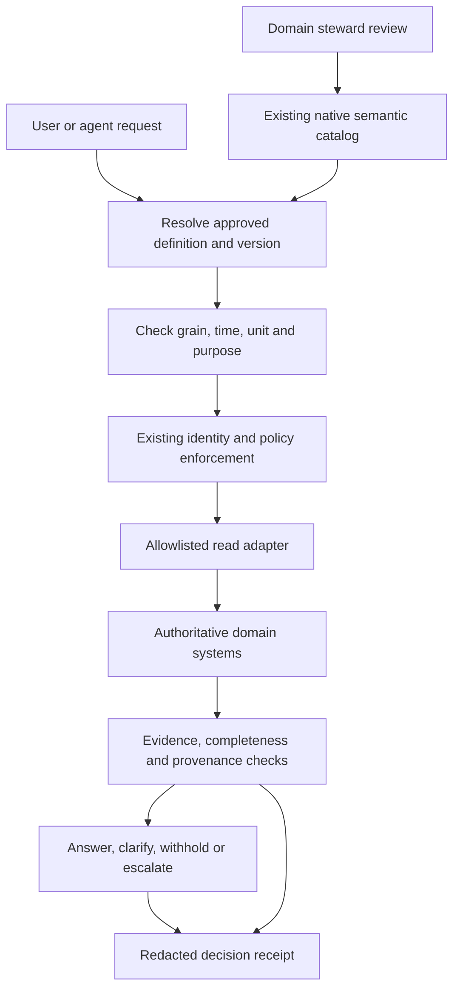

# CTO decision brief: governed semantic decisions

**Decision requested:** sponsor one bounded, read-only evaluation around a disputed business metric, using the semantic platform already in place.

**Status:** proposed reference architectures, not delivered industry integrations. The runnable repository demonstrates synthetic finance and service-reliability decisions only. It does not establish market leadership, customer adoption, compliance, or production readiness. [Reuse rights remain unresolved](../LICENSE-STATUS.md).

## Why a CTO should care

A technically correct query can still answer the wrong business question. “Revenue,” “available capacity,” and “on-time delivery” each change meaning with population, time basis, exclusions and authority. A graph connects concepts; a decision contract specifies when those connections support an answer and when they do not.

The proposed method is **definition → binding → authorized read → evidence → bounded answer**. Its value must be measured against the team's current stack, not assumed from a new vocabulary. Adopt the acceptance-test pattern first, not a parallel semantic platform.

## Choose the architecture by decision, not by logo

| Blueprint | First decision | Critical semantic distinction | Accountable domain owner |
| --- | --- | --- | --- |
| [Energy / Oil & Gas](industries/ENERGY.md) | Reconcile production and revenue | Operated versus owned; produced versus entitled | Production accounting and finance |
| [Financial services](industries/FINANCIAL-SERVICES.md) | Explain an exposure-report discrepancy | Legal counterparty versus group; gross versus net | Risk methodology owner |
| [Healthcare](industries/HEALTHCARE.md) | Explain capacity-report disagreement | Physical beds versus staffed, available capacity | Clinical operations and data steward |
| [Manufacturing](industries/MANUFACTURING.md) | Compare production performance | Planned time versus run time; count versus quality | Plant operations and quality |
| [Retail / distribution](industries/RETAIL.md) | Compare fulfillment promises | Order versus line versus shipment; promised versus revised date | Fulfillment operations |

These five are a selected initial scope, not a market-ranking claim. Start with energy for continuity with the existing fixture. The other blueprints are deliberately different transfer hypotheses requiring domain review.

## Target architecture and trust boundaries

This is a proposed runtime architecture. Diagram edges are not implemented connections. The current local planner does not authenticate identities or execute live reads.

- **Governance plane:** keep canonical definitions in the existing platform when adequate. Salesforce-centered stewardship is one deployment option; a custom registry requires an explicit gap decision.
- **Execution plane:** existing API/source controls authenticate the caller and enforce tenant, row, field and purpose restrictions. The agent cannot grant itself authority.
- **Evidence plane:** bind query parameters, definition revision, source revision and completeness observations to the result. Separate data provenance from explanation evidence.
- **Observation plane:** retain redacted receipts under an approved retention/access policy. Metadata and refusal messages can also expose sensitive information.

A shared label is not a join key. A successful export is not an authorization proof. An arithmetic bridge is not automatically a causal explanation.

## Architecture options and decision rule

| Option | Choose when | Main cost / rejection condition |
| --- | --- | --- |
| Native semantic layer plus contract tests | Existing platform expresses the needed meaning and ownership | Reject custom registry work that merely duplicates this |
| Reviewed semantic sidecar | Native platform lacks a bounded field or evidence rule | Requires synchronization, version ownership and drift refusal |
| Shared graph plus decision adapter | Relationships across domains are material to the question | Requires identity resolution and reviewed joins; graph existence is not correctness |
| New enterprise ontology platform | A documented cross-domain gap survives the prior options | Separate business case and operational ownership; not the default recommendation |

Use the [primary-source platform comparison](COMPARISON.md) as context, not as a performance ranking. The prototype's [SKOS projection](STANDARDS-EXPORT.md) preserves vocabulary, not executable decision or access semantics.

## Minimum decision contract for a pilot

This is a proposed design checklist, **not a new supported JSON schema**. Map it to native structures and record any sidecar fields.

| Contract element | Required decision |
| --- | --- |
| Identity and ownership | Namespaced semantic ID, immutable revision, steward and authenticated approval |
| Meaning | Definition, population, exclusions, aggregation grain and permissible interpretation |
| Time and quantity | Event/accounting/observation time, timezone, effective interval, unit and conversion basis |
| Binding | Pinned native model/schema, source identifiers, transformation and allowlisted operation |
| Access | Verified identity reference, tenant, purpose, row/field policy; enforced outside the model |
| Evidence | Source references, observation time, freshness limit, completeness and reconciliation support |
| Outcomes | Conditions for answer, clarification, withheld explanation, denied read and escalation |
| Change | Review owner, dependency impact, revocation behavior and rollback version |

## What exists and what must be built

| Concern | Repository evidence | Missing pilot evidence |
| --- | --- | --- |
| Ambiguity, dimensions and read binding | [Finance evaluation](EVALUATION.md) | Native metadata mapping and steward-reviewed meanings |
| Evidence completeness and aligned time | [Reliability contract](SECOND-DOMAIN.md) | Industry-specific implementation and independently chosen cases |
| Vocabulary interchange | [SKOS loss report](STANDARDS-EXPORT.md) | Reviewed industry mappings; native import compatibility |
| Semantic change | [Change review](CHANGE-REVIEW.md) | Deployment/revocation workflow and actual downstream dependencies |
| Identity and execution | [Metadata probe scope](SANDBOX-INTEGRATION.md) | Real allowed/denied principals and source-enforced reads |

## Operating model

The CTO sponsors the architecture decision. The domain steward owns meaning and acceptance labels. The platform owner owns native bindings and availability. Security/privacy owners approve access, logging and retention. An evaluator outside the implementation team owns held-out cases and records their relationship to the project. A named incident owner can disable the adapter without deleting source definitions.

Do not concentrate proposer, approver and evaluator in the same actor. An LLM-generated definition remains a proposal. Review semantic changes like API changes: inventory dependents, compare revisions, exercise old and new cases, approve migration, and revoke stale bindings.

## Investment and stop/go decision

Begin with one metric pair, one source boundary and read-only scope. Budget engineering effort for native export/mapping, domain review, policy integration, evidence capture and operations. No cost-saving or ROI estimate is asserted here; measure analyst correction time, query overhead and review burden in the pilot.

Use the [pilot and decision kit](CTO-PILOT-KIT.md). Stop if the incumbent already handles the problem adequately, no authoritative owner exists, reuse is uncleared, a required native mapping silently loses meaning, or access restrictions cannot be enforced at the source.

**Success is an independently reproducible, useful decision improvement with acceptable operating cost. It is not another ontology diagram or a higher test count.**
