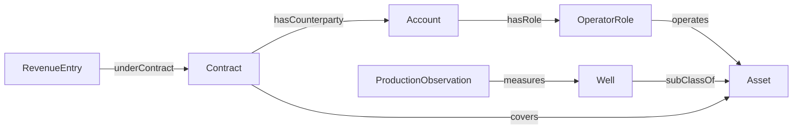

# Oil & Gas ontology map

This diagram is generated from [ontology.json](../ontology.json). It describes concept types, not customer records. The graph is a lightweight registry, not an OWL inference model.

<!-- BEGIN GENERATED GRAPH -->

<!-- END GENERATED GRAPH -->

## How to read it

- An Account has an OperatorRole. Operation does not imply ownership.
- A Well specializes Asset. ProductionObservation measures a well, not revenue.
- A Contract covers assets and identifies counterparties.
- RevenueEntry belongs to a contract. Production needs additional commercial and accounting rules before it can explain revenue.

## Metric bindings

| Metric | Source fixture | Read operation |
| --- | --- | --- |
| `booked_revenue` | `fixture:crm:contract_bookings` | `read_contract_bookings` |
| `recognized_revenue` | `fixture:erp:revenue_ledger` | `read_recognized_revenue` |

Both metrics use operator, contract, period, and currency as their grain. Bindings are checked as metric/source/operation triples. Definitions and lifecycle dates are in the [data model](DATA-MODEL.md).

## Deliberate boundaries

Temporal role intervals, relationship cardinality, actual identifiers, identity resolution, and production-to-finance mappings are not implemented. Adding graph edges does not prove those semantics.

The verification script checks the graph block against the registry so the diagram cannot silently drift.
