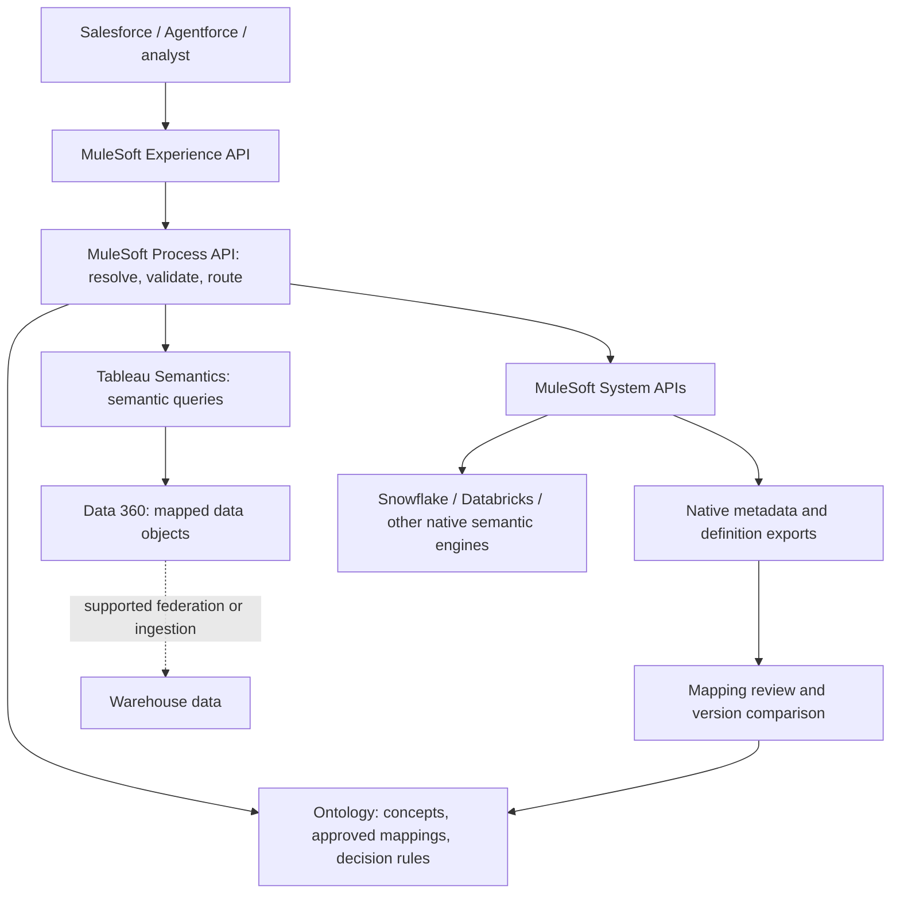

# Data 360 semantic federation through MuleSoft

Author: Michael K. Saleme | Prepared 2026-11-13 | Reference design, not deployed

## Recommendation

Use Data 360 for Salesforce-centered data access and harmonization, Tableau Semantics for analytical definitions and queries, and our ontology for business-concept identity, approved source/action bindings and decision acceptance. Keep authoritative warehouse metrics in their existing platforms. MuleSoft orchestrates metadata synchronization, bounded queries and typed responses. Do not rebuild metric engines or translate arbitrary SQL/DAX formulas automatically.

The existing ontology is a synthetic decision testbed, not a production catalog, universal semantic engine or authorization boundary. These are candidate mappings into its actual fields; native identifiers and runtime bindings still require platform-owner validation.

## Architecture



Two separate paths: Data 360 can access source data through supported zero-copy/federation or ingestion, while MuleSoft can invoke an authoritative external semantic engine directly. Choose one execution authority per metric/request. A federated table is not an imported semantic model. Do not put MuleSoft in the middle of bulk reads unnecessarily.

## How to use Data 360

1. Select one question: recognized revenue for an operator and accounting period. Pin the existing `recognized_revenue` definition, not the ambiguous label 'revenue'.
2. Connect approved source data. Prefer a supported native federation route where appropriate; use ingestion when required. Confirm connector, region, entitlement, freshness and query limits in the designated org.
3. Map source Data Lake Objects (DLOs) to appropriate Data Model Objects (DMOs), using custom objects only where standard objects do not fit. Preserve namespaced source keys. `Account`, `Contract`, `Asset`, `Well`, `ProductionObservation`, `RevenueEntry` and effective-dated `OperatorRole` are our logical concepts, not assertions that Salesforce supplies identically named standard DMOs.
4. Model relationships with explicit grain, cardinality and effective-time rules. An operating role is not ownership; account identity resolution does not establish the current operator of an asset. Validate temporal joins separately.
5. Author a Tableau semantic model over the approved data objects: dimensions for operator, contract, accounting period and currency; the steward-approved recognized-revenue measure; exclusions and reversal handling. Use Authoring APIs for governed definition changes and the Semantic Query API for reads. A calculated insight may be useful for a precomputed metric but is not interchangeable with every semantic model or measure.
6. Bind our local metric ID to the native model/measure identity plus pinned definition revision. Store only governance gaps in a reviewed sidecar: lifecycle, authenticated approval evidence, exact read-operation binding, and explanation requirements. Do not copy an already authoritative formula into a second editable catalog.
7. Expose a typed read response through MuleSoft to Salesforce/Agentforce. Use a supported integration route selected in the org; this document does not supply a deployed Agentforce action.
8. Return metric, dimensions, amount, currency/unit, data-as-of, native query reference, mapping revision and limitations. Reconciliation explanations require evidence beyond arithmetic.

## MuleSoft implementation design

These API names are proposed contracts, not deployed endpoints.

- **System APIs:** `readSemanticDefinition`, `executeApprovedMetric`, `readSourceReceipt`. Wrap each platform's supported metadata/query API, SQL interface or controlled export. Use the Data Cloud connector (still its documented connector name) for supported Data 360 ingestion, queries and calculated insights. Use an authenticated HTTP integration for Tableau Semantics REST APIs where the connector does not expose the operation. Do not assume the Data Cloud connector implements semantic authoring/query operations.
- **Process API:** `resolveMetric` resolves native identity; `validateMapping` checks version/grain/units/time; `queryMetric` chooses one engine and performs only an allowlisted parameterized operation; `reconcile` compares compatible values and attaches a separately evidenced explanation bridge.
- **Experience API:** `getDecisionAnswer` returns a compact answer/evidence envelope or an actionable clarification/gap. It must never silently fall back to a similarly named metric.
- **DataWeave role:** normalize metadata envelopes and response fields, namespaced keys, timestamps and approved unit conversions. Preserve formulas as native references or opaque versioned expressions. DataWeave renaming does not prove formula equivalence, financial correctness or policy preservation.
- **Transport and identity:** configure supported OAuth and least-privilege backend access. API gateway authentication is not row-level authorization. Prove caller-to-source authorization, or use an explicitly approved delegated-access design. A shared broad service account must not expand a caller's permitted rows. Partition caches by effective principal/policy, metric revision and query scope.
- **Operations:** change events where supported, otherwise bounded metadata polling. Definition changes become pending review, never auto-approved. Stop stale bindings; return owner/action. Treat timeout, pagination and partial results as incomplete. Read-only pilot, no operational write-back.

## Canonical mapping to the existing registry

| Local field | Cross-platform mapping requirement |
| --- | --- |
| `concepts[].id`, `definition` | Native business entity/table identity plus description; retain local logical concept identity |
| `relationships[]` | Native relationship/join reference plus predicate and reviewed cardinality/time semantics; subclass and temporal roles may need sidecars |
| `metrics[].id`, `label`, `definition` | Stable local metric identity linked to namespaced native model/measure identity; label is not identity |
| `version` | Reviewed mapping revision pinned to native definition revision or export digest; a digest is not approval |
| `grain` | Dimensions, join path and lowest valid grouping; reject unsafe fan-out or incompatible rollups |
| `aggregation` | Native metric expression/operator; local fixture supports sum, not arbitrary native formulas |
| `unit` | Currency, scale and numeric precision; explicit reviewed conversion only |
| `source_binding`, `lineage` | Native model/metric/source IDs and available lineage references, not fixture strings |
| `valid_from`, `valid_to` | Definition lifecycle dates; separate from accounting period and data freshness |
| `status`, `approval` | Authenticated steward disposition or reviewed sidecar; imported labels never self-approve |
| `action.operation_id` | Fixed MuleSoft read contract and version, allowlisted backend binding |
| `action.required_scope` | Gateway permission requirement, not a replacement for source row/field controls |
| `action.implementation` | Must remain `local_fixture_only` in current runtime; live adapter requires separate implementation and evidence |

No native export should be inserted into ontology.json unchanged. The runtime still contains fixture-specific source/operation constraints. See [the machine-readable crosswalk](CROSSWALK.json) for six platform mappings, residual semantic loss and candidate execution routes.

## Platform-to-ours crosswalk

| Platform | Native meaning to reuse | Mapping into ours | MuleSoft route and key loss risk |
| --- | --- | --- | --- |
| Salesforce Data 360 + Tableau Semantics | DMO relationships, semantic definitions/models, dimensions and measures | DMO identities to concepts/source binding; model + measure to metric ID binding; dimensions to grain | Data Cloud connector for documented operations; Tableau Semantics REST through HTTP. DLO-to-DMO mapping alone does not supply metric semantics or approval. |
| Snowflake | Semantic View logical tables, relationships, dimensions, facts and metrics | Logical table to concept; join to relationship; metric to definition/source binding; dimensions to grain | Approved native query/metadata interface behind System API. Facts are row-level values, not automatically aggregate metrics; SQL joins and null behavior need equivalence checks. |
| Databricks | Unity Catalog metric view source, joins, dimensions and measures | Source/catalog identity to binding; dimensions to grain; measure expression to native metric reference | Approved SQL/metadata interface behind System API. Preserve join/filter/window semantics and UC authorization; do not sum already aggregated or non-additive measures. |
| dbt Semantic Layer | Semantic models, entities, dimensions and metrics executed by MetricFlow | Entities to concept keys; dimensions/time dimension to grain; metric to native identity/expression reference | Supported Semantic Layer API/export behind System API. Pin project/environment and schema version; cumulative/ratio metrics cannot be translated to local sum. |
| Looker | LookML models/views, Explores, dimensions, measures and joins | Model/Explore/view/field-qualified identity to binding; dimensions to grain; reviewed joins to relationships | Supported Looker query/metadata API behind System API. Preserve filters, access context, fan-out protection and measure calculation; do not bypass LookML by querying base tables. |
| Microsoft Fabric / Power BI | Semantic model tables, relationships, columns and DAX measures | Workspace/model/measure identity to binding; dimension columns to grain; DAX retained as native reference | Approved model query/metadata interface behind System API, subject to tenant capabilities. DAX filter context, calculation groups and RLS/OLS do not translate mechanically to SQL sum. |

## Worked mapping: recognized revenue

Our existing fixture defines `recognized_revenue` as revenue for satisfied performance obligations during the accounting period, net of reversals. Grain: `operator_id`, `contract_id`, `period`, `currency`. Unit: `currency_minor_units`. Operation: `read_recognized_revenue`. Its approval is synthetic, not a real finance sign-off.

Candidate native references, all illustrative and unprovisioned:

- Tableau: semantic model `finance_revenue`, measure `recognized_revenue`.
- Snowflake: `FINANCE.CORE.REVENUE_SEMANTICS`, metric `recognized_revenue`.
- Databricks: `finance.core.revenue_metrics`, measure `recognized_revenue`.

All three map to the same local metric only after finance verifies definition, accounting basis, exclusions, dimensions, operator-role effective dates, period/calendar and currency scale. Choose a single authority; alternative bindings are comparison targets, not values to add together. If one source is bookings, rename/map it to `booked_revenue` or reject the match, even if its column is called revenue. A recognition-timing difference needs separate reconciliation evidence.

### Proposed response shape

```json
{
  "status": "requires_binding_review",
  "metric_id": "recognized_revenue",
  "mapping_revision": "draft-2026-11-13",
  "native_platform": "snowflake",
  "native_metric_ref": null,
  "dimensions": ["operator_id", "contract_id", "period", "currency"],
  "unit": "currency_minor_units",
  "amount": null,
  "data_as_of": null,
  "query_receipt": null,
  "owner": "designated-finance-steward",
  "next_action": "Approve one native metric identity and definition, then bind the read operation."
}
```

No fabricated result, principal or query receipt. Proposed envelope is not the current resolver API.

## Acceptance and useful next increment

First integrate one Data 360/Tableau metric and one Snowflake counterpart through a single MuleSoft process contract. Databricks is the next adapter; other mappings remain a reusable design checklist.

Require: valid aligned answer; booked-vs-recognized rejection; major/minor unit mismatch; currency mismatch; fiscal/calendar period mismatch; temporal operator-role mismatch; duplicate-join fan-out; stale definition; non-additive measure; partial result; source denial; cross-principal cache denial. Include valid alternatives so blanket refusal cannot pass. Compare identical approved snapshots and principal scopes. Live source-denial tests need approved test identities.

Success: same business meaning and expected value under equivalent scope, explicit refusal of materially different definitions, and fewer analyst minutes/clarification rounds including setup cost. No claim of time savings until measured.

**Current completion:** six documented platform crosswalks grounded in official sources, mapped to the actual local registry. No deployed Mule app, adapter, org connection, vendor execution or interoperability proof. Live progress requires designated sandbox, entitlements, approved native exports/bindings and test identities. No credentials or new purchase requested for this design work.

## Sources and retrieval limitations

Official pages fetched 2026-11-13. Product documentation supports native concepts, not the proposed adapter's correctness. Some extracts were truncated; statements are confined to observed text or explicitly proposed mappings. No live vendor execution was performed.

- [Tableau Semantics Authoring and Query APIs](https://developer.salesforce.com/docs/data/semantic-layer/guide/get-started.html)
- [MuleSoft Salesforce Data Cloud Connector 1.5](https://docs.mulesoft.com/salesforce-data-cloud-connector/latest/)
- [Snowflake Semantic Views](https://docs.snowflake.com/en/user-guide/views-semantic/overview)
- [Databricks Unity Catalog metric views](https://docs.databricks.com/aws/en/uc-semantics/metric-views)
- [dbt Semantic Layer](https://docs.getdbt.com/docs/use-dbt-semantic-layer/dbt-sl)
- [LookML concepts](https://docs.cloud.google.com/looker/docs/lookml-terms-and-concepts)
- [Power BI semantic models](https://learn.microsoft.com/en-us/power-bi/connect-data/service-datasets-understand)

Open semantic interchange may eventually reduce custom mapping effort, but no format conformance, automatic round-trip or universal connector is claimed. Pin and evaluate the actual specification before adopting it.

## Implementation packet

- [MuleSoft contract and implementation sequence](MULESOFT.md)
- [Pilot acceptance matrix and evidence worksheet](PILOT.md)
- [Machine-readable crosswalk](CROSSWALK.json)

Return to the [repository overview](../../README.md).

## Extension boundaries

See [Data 360, Tableau Semantics and six-platform federation](ARCHITECTURE.md) for native metric reuse and [MuleSoft contracts](MULESOFT.md) for the proposed integration boundary. Native formulas and source authorization remain authoritative; the current runtime remains offline with unverified supplied evidence.
